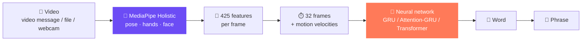

<p align="center">
  <a href="README.md"></a>
  <a href="README.ru.md"></a>
</p>

<div align="center">

<a href="https://t.me/zhestik_bot"></a>

# Zhestik 🤟

### Russian Sign Language to text translator

Record a Telegram video message or a video on the website: the neural network finds the hands, face and pose<br/>
and translates Russian Sign Language (RSL) gestures into text in a couple of seconds.

<br/>

<a href="https://t.me/zhestik_bot"></a>

<br/><br/>


</div>


---

## ✨ Features

|  |  |
|---|---|
| 📹 **Video messages and videos** | The bot accepts video messages, videos and video files up to 20 MB; the website accepts webcam recordings and files up to 50 MB |
| 🧩 **Phrases, not just words** | A long video is split with a sliding window, and the signs are joined into a phrase: *"Hello, I am glad"* |
| 🎯 **Model confidence** | A probability for every word; when the model is unsure, similar options are shown |
| 📚 **400 signs** | A searchable dictionary with an alphabetical index, in the bot and on the website |
| 🌗 **Web version** | In-browser camera recording, file upload, text-to-speech of the translation, light and dark themes |
| ⚡ **Runs on CPU** | The model has ~1–2M parameters; a GPU is only needed for fast training |
| 🔄 **Hot model swap** | The bot and the website pick up a new model automatically, without a restart |

---

## 🧠 How it works

Zhestik looks at **skeleton motion**, not pixels, so background, lighting, clothing and appearance do not matter.



**1. Skeleton.** MediaPipe Holistic, a pretrained frozen network from Google, finds 140+ landmarks in every frame.

**2. Features.** Landmarks are normalised relative to the shoulders (so it does not matter where the person stands or how far they are from the camera) and packed into a 425-number vector:

| Block | What it describes | Size |
|---|---|:---:|
| 🧍 Pose | shoulders, elbows, wrists, head | 75 |
| ✋ Hands relative to the body | *where* the hands are | 63 × 2 |
| 🤌 Hand shape | *which* shape: fist, finger, "V" | 63 × 2 |
| 👄 Face | lips and eyebrows: facial expression carries meaning | 96 |
| 🚩 Flags | whether the left / right hand was found | 2 |

**3. Classification.** The clip is resampled to 32 frames, velocities are added to the coordinates, and the network recognises the sign from the motion sequence. Only the network is trained; MediaPipe is used as an off-the-shelf feature extractor.

**4. Phrase.** For long videos a 1.6 s window slides over the recording; a word counts only if several consecutive windows confidently agree.

### Architectures

| `--arch` | Design |
|---|---|
| `gru` | Linear → BiGRU (2 layers) → temporal mean → classifier |
| `attn_gru` | Residual Conv1D blocks → BiGRU → attention / mean / max pooling → MLP |
| `transformer` | Positional encoding → Transformer Encoder → attention / mean pooling |

Training augmentations: mirroring (left-handed ↔ right-handed), temporal cropping, rotation, scaling, tracking noise, hand dropout. Validation is **signer-disjoint**: the same person never appears in both training and validation.

---

## 📊 Results

The model currently used by the bot and the website is `gru` on **401 classes** (400 signs + "no sign").
Metrics on a validation set of people the model never saw during training:

| Vocabulary | Model | Accuracy | Macro-F1 | Balanced acc. |
|---|---|:---:|:---:|:---:|
| 400 signs + "no sign" | `gru` | **56.7%** | **0.544** | **56.1%** |

For reference, random guessing among 401 classes gives 0.25%. The training split has only ~10 examples per sign.

---

## 📚 Vocabulary

**400 signs** + a "no sign" class from the open Slovo dataset (SberDevices).

<details>
<summary><b>Example words</b></summary>

<br/>

**Greetings:** hello · bye · welcome · happy birthday
**Pronouns:** I · you · we · you (plural) · me · you (object) · my · your · our
**Questions:** who · what · when · why · how many
**People:** mother · father · brother · sister · friend · family · child
**Actions:** want · know · understand · help · eat · drink · go · work · love
**Time:** today · tomorrow · yesterday · morning · evening · Monday … Sunday
**Evaluations:** good · bad · very · glad · tasty · interesting

The full list (in Russian) is in the bot ("📝 Список слов" button), on the website, or in `src/translator/vocab.json`.

</details>

---

## 🚀 Quick start

### 1. Installation

```bash
git clone https://github.com/Vladisluv12/vibehack.git
cd vibehack
git checkout translator

python3.12 -m venv .venv
source .venv/bin/activate
pip install -r requirements-training.txt
pip install aiogram aiohttp-socks python-decouple fastapi "uvicorn[standard]" python-multipart
```

PyTorch is installed separately: a CUDA build for GPU training, or the CPU build:

```bash
pip install torch --index-url https://download.pytorch.org/whl/cpu
```

### 2. Configuration

Create `.env` in the project root:

```env
BOT_TOKEN=123456:ABC-token-from-BotFather
TG_PROXY=socks5://127.0.0.1:12334
```

`TG_PROXY` is optional: the SOCKS port of a VPN client, if Telegram is not reachable directly.

The model used by the bot and the website is `models/sign_gru.pt`.

### 3. Bot and website with one command

```bash
bash run.sh
```

The bot starts replying in Telegram, and the website opens at `http://localhost:8000`. Ctrl+C stops both.

Or separately:

```bash
python src/translator/bot.py --check
python src/translator/bot.py
python src/web/app.py
```

The in-browser camera only works on `localhost` or over `https`.

### 4. Real-time webcam and file recognition

```bash
python src/translator/realtime.py
python src/translator/recognizer.py path/to/video.mp4
```

---

## 🏋️ Training the model

<details>
<summary><b>Full cycle: from videos to a model</b></summary>

<br/>

**1. Dataset.** Download Slovo and unpack it into `data/slovo/` (`annotations.csv`, `train/`, `test/`).

**2. Vocabulary.**

```bash
python src/translator/make_vocab.py --words-file src/translator/words_basic.txt --size 400
```

**3. Landmark extraction** is the slowest step (MediaPipe runs on CPU only). It can be spread across several machines in proportion to their core count:

| Machine | Cores | Command |
|---|:---:|---|
| 1 | 16 | `python src/translator/extract_slovo.py --shard 0,1,2,3/8 --workers 14 --max-side 640 --frame-step 2` |
| 2 | 12 | `python src/translator/extract_slovo.py --shard 4,5,6/8 --workers 10 --max-side 640 --frame-step 2` |
| 3 | 4 | `python src/translator/extract_slovo.py --shard 7/8 --workers 3 --max-side 640 --frame-step 2` |

**4. Merge** the results on one machine:

```bash
python src/translator/merge_kp.py pack
python src/translator/merge_kp.py unpack data/kp_*.zip
python src/translator/merge_kp.py check
```

**5. Training, architecture search and final evaluation:**

```bash
python src/translator/train.py --arch gru --epochs 100 --patience 15 --device cuda
python src/translator/experiments.py --space configs/search-small.json --method grid --trials 12 --folds 3 --device cuda --refit
python src/translator/evaluate.py --model runs/search_<timestamp>/final/best.pt --device cuda
```

**6. Plug the new model** into the bot and the website:

```bash
cp runs/<run_folder>/best.pt models/sign_gru.pt
```

</details>

---

## 🗂️ Project structure

```
vibehack/
├── run.sh                       # bot + website with one command
├── models/sign_gru.pt           # model for the bot and the website
├── src/
│   ├── translator/
│   │   ├── features.py          # vocabulary, 425 per-frame features, normalisation
│   │   ├── model.py             # gru · attn_gru · transformer
│   │   ├── extract_slovo.py     # video → landmarks (split across machines)
│   │   ├── merge_kp.py          # merge landmarks from several machines
│   │   ├── make_vocab.py        # build the vocabulary → vocab.json
│   │   ├── train.py             # train one configuration
│   │   ├── training.py          # data, augmentations, folds, metrics
│   │   ├── experiments.py       # configuration search with cross-validation
│   │   ├── evaluate.py          # final test evaluation
│   │   ├── recognizer.py        # video file recognition (bot + website)
│   │   ├── realtime.py          # webcam recognition
│   │   └── bot.py               # Telegram bot
│   └── web/
│       ├── app.py               # FastAPI backend
│       └── static/index.html    # web interface
├── configs/                     # hyperparameter search spaces
├── tests/                       # training unit tests
├── data/                        # dataset and landmarks (in .gitignore)
└── runs/                        # training outputs (in .gitignore)
```

---

## 🛣️ Roadmap

- [x] Isolated sign recognition from landmarks
- [x] Telegram bot: video messages, videos, multi-sign phrases
- [x] Web version with camera recording
- [x] 400-sign vocabulary, distributed feature extraction
- [ ] Turn a sequence of signs into a grammatical Russian sentence with an LLM
- [ ] Recognition directly in the browser
- [ ] Fine-tuning on custom recordings

---

## 🙏 Acknowledgements

- **Slovo** — open Russian Sign Language dataset by SberDevices
- **MediaPipe** — body, hand and face landmark extraction
- **aiogram** and **FastAPI** — bot and web server

<div align="center">

<br/>

<a href="https://t.me/zhestik_bot"></a>

<br/><br/>

Made with 💜 at the "Vibecoding FCS" hackathon

</div>
